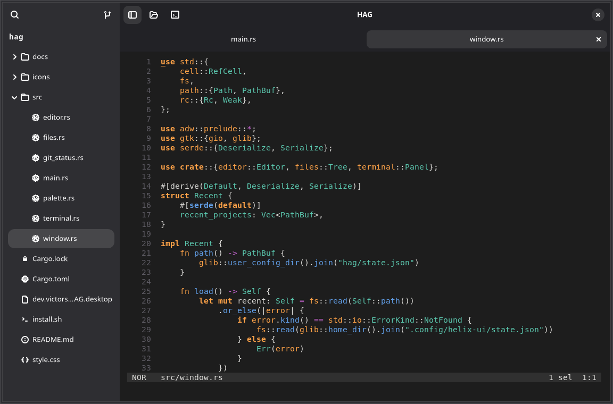
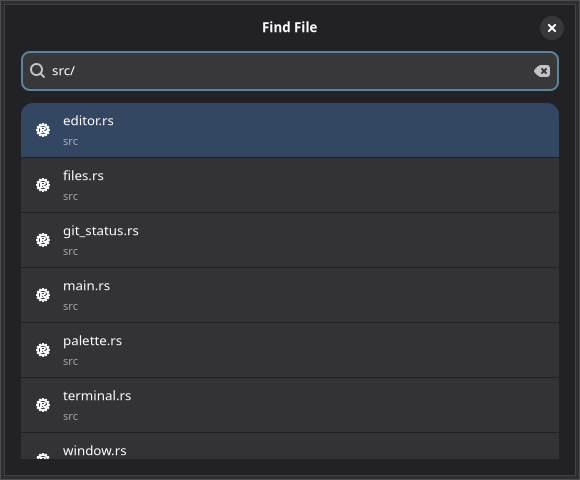

<p align="center">
  
</p>
<h1 align="center">HAG</h1>
<p align="center"><strong>Helix Adwaita GUI</strong></p>

HAG is an independent GNOME frontend for [Helix](https://helix-editor.com/). Browse your project in a native file tree, switch between files with tabs, and edit with Helix using your own keybindings and theme.



## Working with projects

Choose **Open Folder…** on the welcome screen, or pick a recent project. Once you're editing, the folder button and **Ctrl+O** open the next project in its own window. Your current files and terminal sessions stay open.

The sidebar shows Git status for tracked files. Hover over a badge for details. **M** marks a modified file, **S** a staged file, **SM** a staged file with additional edits, and **!** a conflict. Right-click a file or folder for actions such as rename, copy path, and move to trash.

Drag a file or folder onto another folder to move it. Drop it on the project name above the tree to move it back to the root. Existing items at the destination are preserved.

Images open in the system’s default application from either the tree or Find File. SVG files open as source in Helix. To preview an SVG, right-click it and choose **Open in Image Viewer**.

### Find a file

Press **Ctrl+P**, type part of a filename or path, and use the arrow keys and **Enter** to open a match.



## Build and run

You'll need Rust 1.92 or newer, GTK 4.10+, libadwaita 1.4+, VTE for GTK 4, and Helix. On Arch Linux, install the system packages with:

```sh
sudo pacman -S --needed base-devel pkgconf gtk4 libadwaita vte4 helix gsettings-desktop-schemas
```

From the project directory, run:

```sh
cargo run --release --locked
```

With a Rust toolchain managed by mise, use `mise exec -- cargo run --release --locked`. To install the executable and GNOME desktop launcher for your user, run `./install.sh` (or `mise exec -- ./install.sh`).

Install `git` for file status badges and `lazygit` to open the Git interface inside HAG.

### GitHub Actions builds

The **Build HAG** workflow builds a Linux x86_64 release on pushes, pull requests, and manual runs. Download **hag-linux-x86_64** from the run’s **Artifacts** section and extract the tarball. With the runtime libraries and Helix installed, run `./hag`. To use the bundled file icons, copy the `icons` directory into `${XDG_DATA_HOME:-$HOME/.local/share}/hag/`.

## Keyboard shortcuts

| Shortcut | Action |
| --- | --- |
| Ctrl+O | Open a project folder |
| Ctrl+B | Show or hide the file tree |
| Ctrl+P or Ctrl+Space | Find a file |
| Ctrl+T | Show or hide the terminal panel |
| Ctrl+Shift+T | Open a new terminal |
| Ctrl+Shift+G | Open Lazygit |

Tabs follow files opened through HAG. When Helix reports the filename in its terminal title, HAG can also follow buffer changes made inside the editor. Save your edits before closing a project window.

## Application icon

To use different artwork, replace `icons/hicolor/scalable/apps/HAG.svg` and run `./install.sh` again. The same icon appears on the welcome screen and in the GNOME launcher.
